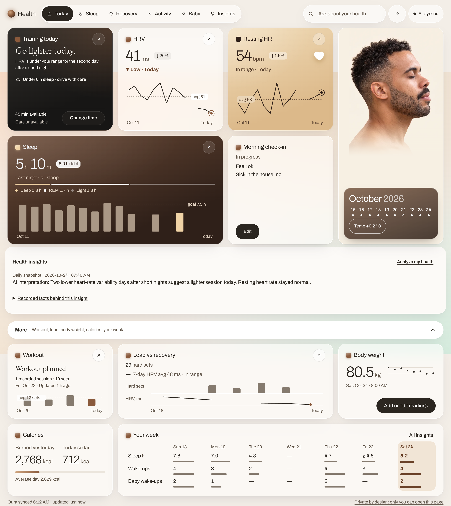
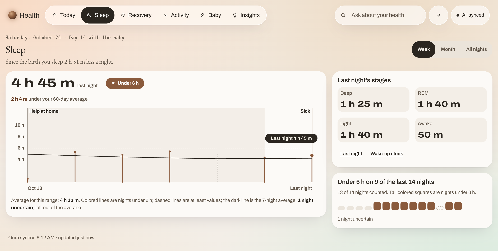
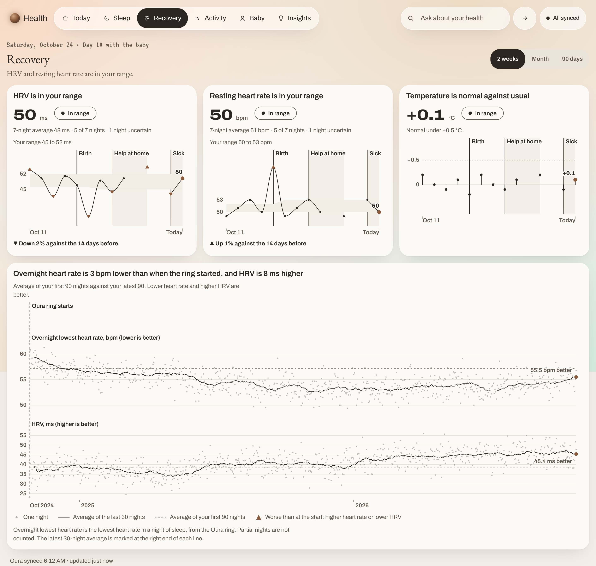

# Daywell

A health dashboard I designed around my own data.

Daywell reads my Oura ring each day and turns the night into one training call: train hard, go lighter, or rest. Today shows that call with sleep, heart-rate variability, resting heart rate, temperature, a morning check-in, and the week. Sleep, Recovery, Activity, and Insights each have a page of charts that mark events such as a sick day or help at home. Recovery also compares my first 90 nights with my latest 90. Steps, VO2 max, and workouts come from an Apple Watch through Health Auto Export. I enter body weight by hand, and my private workout tracker reads that history. When I agree to share, a question box sends one or two weeks of selected readings to OpenAI. A daily insight uses the same seven days of readings. Each answer lists the recorded facts it used, and the AI text is labeled as interpretation.

Daywell runs privately on my home server, and only my own Tailscale login can open it. The November 9, 2026 release turned on the daily insight and the question box. Browser checks cover desktop and phone widths, but no one has checked it on a physical iPhone yet. Weight entry is manual; no scale is connected. The AI text cannot change records or the training call.

Screenshots use invented records and my real photo. The working app, its source, and my data are private.
