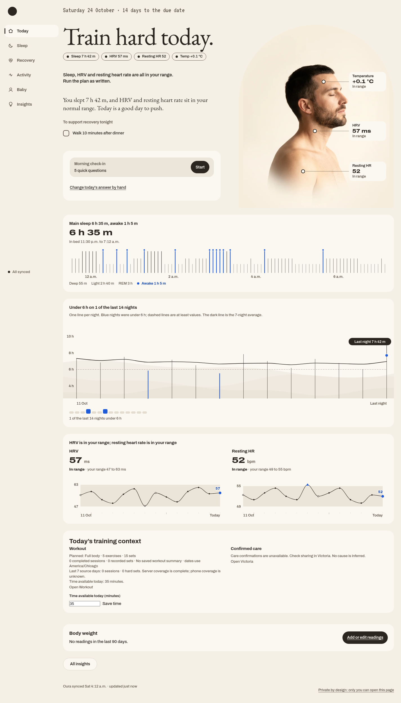

# Daywell

A health dashboard I designed around my own data.

**Status: in development.** This repository shows the current interface.

- Sleep duration, sleep stages, and wake-up patterns.
- HRV, resting heart rate, and temperature compared with personal ranges.
- Date-range views and event markers alongside the charts.
- The Today view pairs a portrait with sleep and recovery markers. Phone acceptance is still in progress.
- Manual body-weight entries and history. The private workout tracker reads this history through a separate connection.

Screenshots use sample data. The working app and its data are private.
