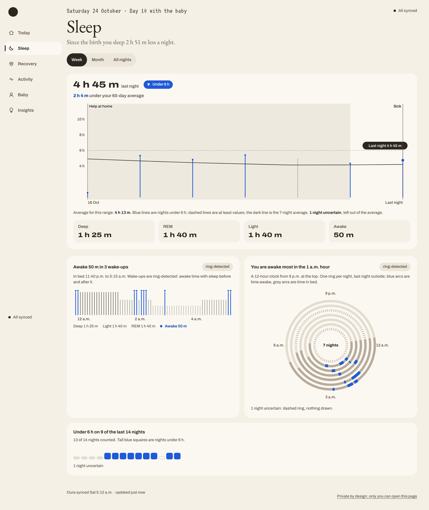
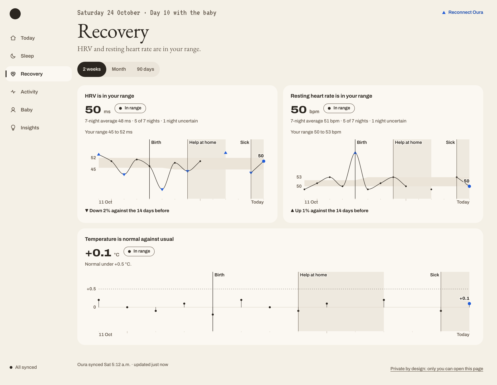

# Daywell

A health dashboard I designed around my own data.

**Status: in development.** This repository shows the current interface.

- Sleep duration, sleep stages, and wake-up patterns.
- HRV, resting heart rate, and temperature compared with personal ranges.
- Date-range views and event markers alongside the charts.

Screenshots use sample data. The working app and its data are private.
